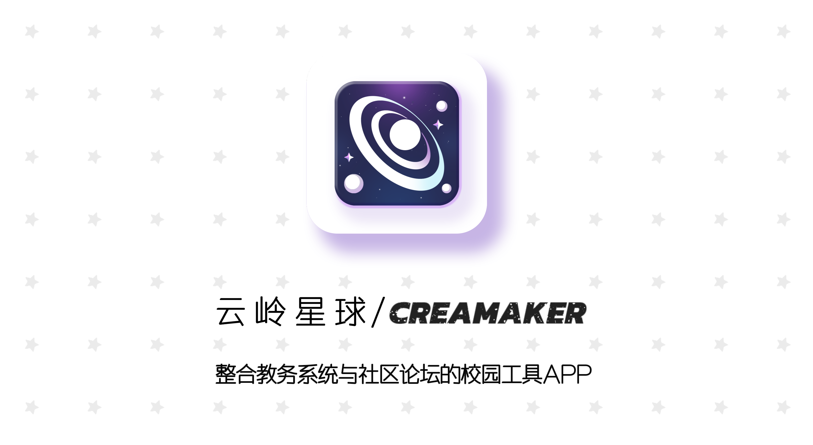
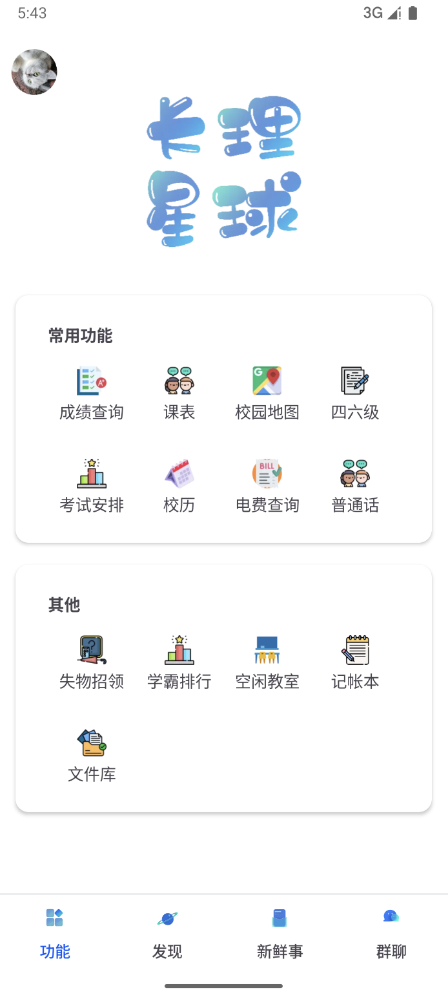
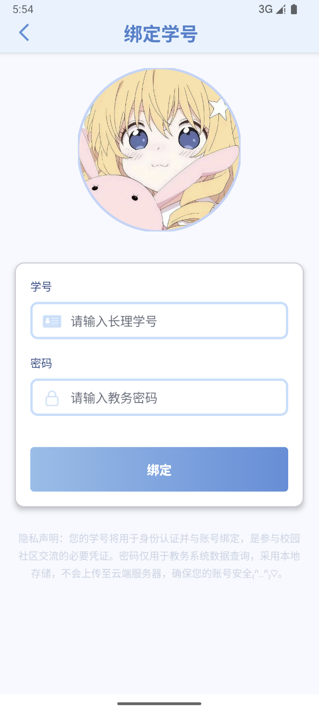
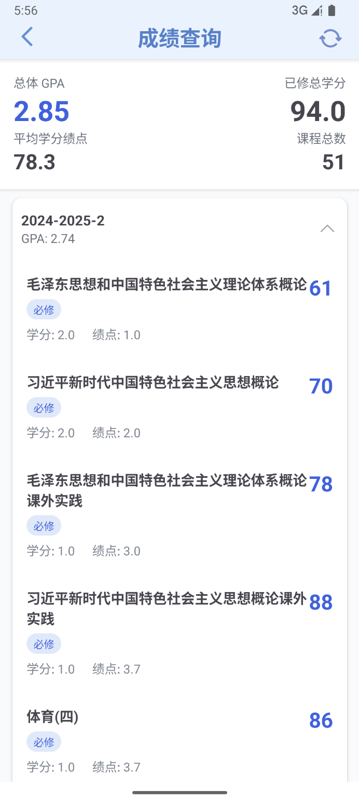
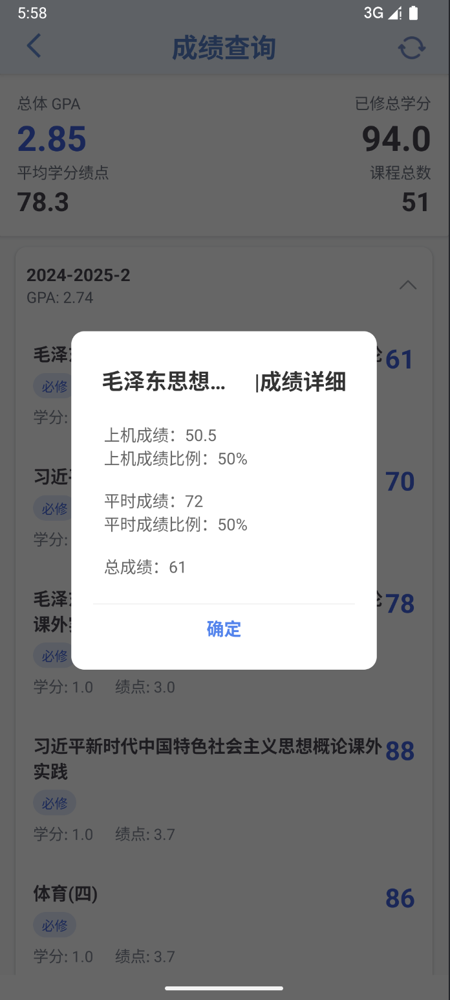
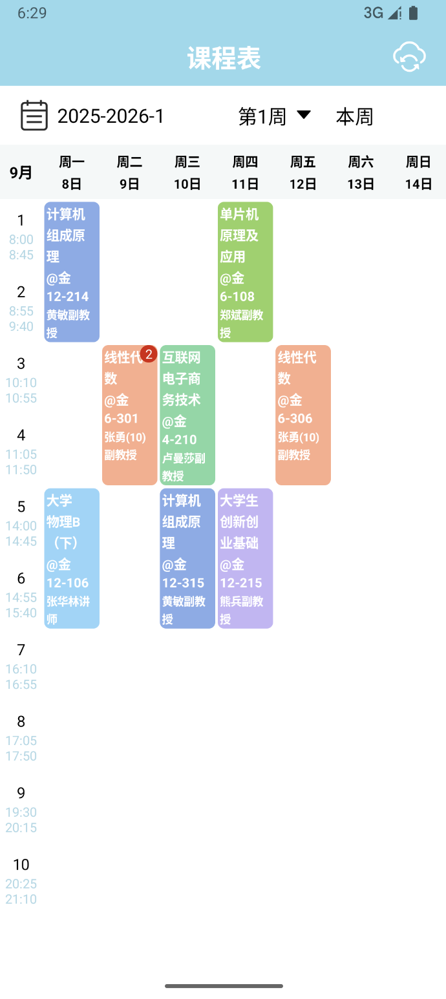
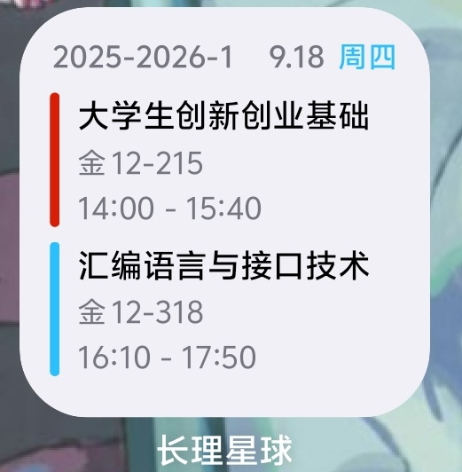

云岭星球是一款开源、轻量的校园工具 App，提供课表查询、课表小组件、成绩查询、考试安排等常用功能。

Android 官方网站：[planet.zhelearn.com/android](https://planet.zhelearn.com/android/)

> 本仓库为云岭星球 Android 客户端源码。产品支持 Android 和 iOS，本仓库的代码与开发文档以 Android 端为准。

## 主要功能

### 功能页面

- 绑定教务系统后，可查询课表、成绩和考试安排。
- 无需登录即可使用空闲教室、电费查询等功能。

|  |  |
| :---: | :---: |

### 成绩查询

> 成绩数据由教务系统提供，仅保存在本地，不会上传云端。

|  |  |
| :---: | :---: |

### 课表查询

> 进入课表页面可查看最新课表。课表会自动存储到本地并定时刷新，在无网络环境下也能查看。

|  |  |
| :---: | :---: |

### 考试安排

> 教务系统发布考试时间后即可查看。

### 其他功能

更多功能可在 App 内自行探索。

## 下载

云岭星球目前支持 Android 和 iOS。Android 版本可前往 [Releases](https://github.com/CreaMakers/changli-planet-app/releases) 下载。

通常建议使用稳定版本。如果你愿意参与测试，并具备一定的 Bug 排查能力，也欢迎使用测试版本提前体验新功能。具体版本类型请查看对应版本的发布说明。

## 参与开发

云岭星球目前需要后端、客户端、产品和视觉设计等方向的贡献者，欢迎提交 Issue 或 Pull Request 参与开发：

- [提交 Issue](https://github.com/CreaMakers/changli-planet-app/issues)
- [分支规范](docs/contribution/分支规范.md)
- [架构初览](docs/contribution/架构初览.md)
- [Android 业务代码框架总览](docs/contribution/长理星球Android业务代码框架总览.md)

## 提供意见

欢迎通过 [GitHub Issues](https://github.com/CreaMakers/changli-planet-app/issues) 反馈问题或提出建议。

## 开源许可

本项目源代码采用 [MIT License](LICENSE) 开源。

> **重要提醒：开源不等于放弃版权。** 通过 Fork、Clone 或其他方式获取本项目代码，并不免除遵守 MIT License 的义务。任何软件副本或包含本项目主要代码的作品，都必须保留原始版权声明和完整的许可声明；二次开发、发布或分发时同样如此。请勿删除、遗漏或规避上述声明。

MIT License 允许使用、复制、修改、合并、发布、分发、再许可及销售本项目代码，但这些权利以遵守许可证所列条件为前提。请尊重项目贡献者的劳动，并在使用代码前完整阅读 [LICENSE](LICENSE)。

## 友链

[计算机学院往年考试题仓库](https://github.com/MedivhTirisfal/csust_test_database)

## FAQ

### 在云岭星球中输入学生账号与密码是否存在泄露风险？

按照项目当前设计，教务系统密码仅保存在本地，不会上传云端；学号等账号绑定信息可能用于云端服务。项目代码公开，便于用户和开发者审阅。请从官方渠道获取应用，并妥善保管自己的账号信息。

### 如何加入？

你可以直接提交 Pull Request 参与云岭星球的开发，无需填写表单。如果希望加入团队并参与长期协作，也可以填写[云岭星球加入表单](https://creamaker.feishu.cn/share/base/form/shrcnOIl2W9rBAcEYYrK12l6Ffd)。
